# KiCadGen

KiCadGen è un'applicazione desktop per Windows che costruisce un componente
per KiCad — footprint (`.kicad_mod`), simbolo elettrico (`.kicad_sym`) e
modello STEP (`.step`) — a partire dai documenti del costruttore e dalle
fotografie del pezzo. Legge i documenti con un modello di intelligenza
artificiale, trasforma quello che il modello ha letto in geometria con regole
deterministiche, permette di rivedere e correggere ogni risultato e installa
il componente in una libreria KiCad.

English version: [README.md](README.md).

> La lettura AI è un punto di partenza, non uno strumento di misura. Controlla
> numerazione dei pin, quote, orientamento e distanze sui documenti del
> costruttore prima di usare un risultato in una scheda.

| Ingresso: una foto dall'alto e i documenti | Risultato: il modello STEP del modulo |
|---|---|
| 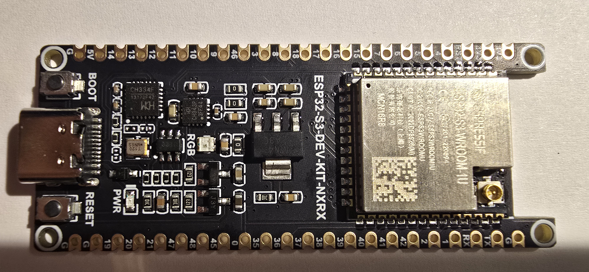 | 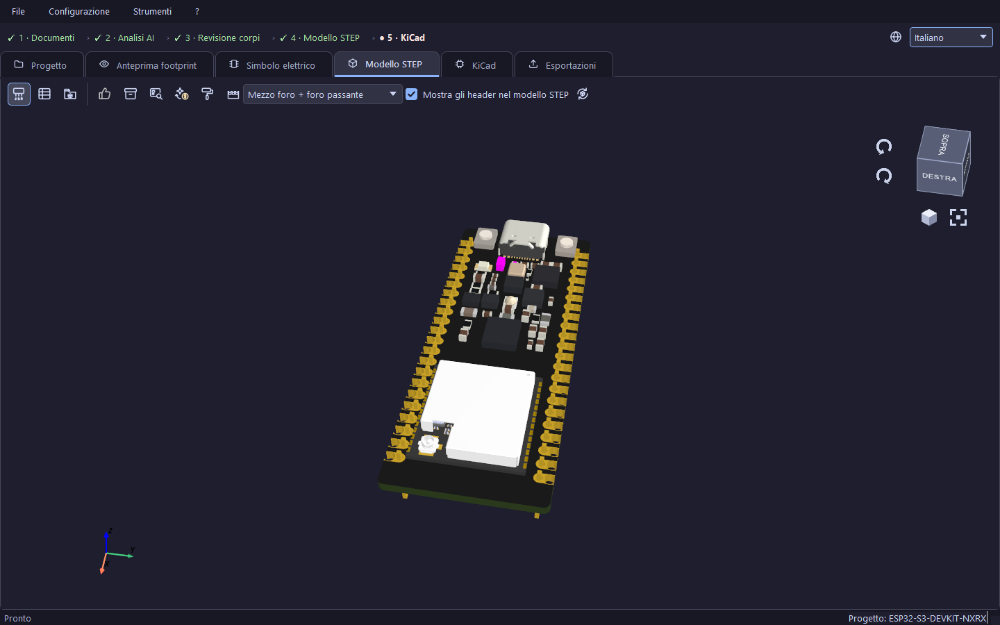 |

## Come funziona

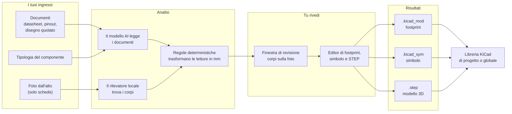

Ogni passo lascia le sue tracce nella cartella del progetto (risposte AI,
costi, log) e niente arriva a KiCad finché non lo installi. Le risposte AI
sulle foto sono in cache: ripetere la stessa richiesta sulla stessa foto non
si paga di nuovo.

## Scopo e non-obiettivi

- **Componenti singoli** (a fori passanti o SMD): piazzole, fori e corpo dal
  datasheet; il simbolo elettrico dal pinout.
- **Schede con componenti montati** (moduli, breakout, con contatti passanti o
  castellated): oltre al footprint e al simbolo, KiCadGen ricostruisce gli
  **ingombri meccanici** dei corpi visibili in una foto dall'alto — posizione,
  dimensioni e orientamento — così il modello STEP mostra che cosa occupa spazio
  sulla scheda.
- **Non** è reverse engineering: i corpi sono volumi generici, oppure modelli
  della libreria 3D di KiCad scelti perché le misure coincidono. Nomi esatti,
  valori elettrici e marcature non sono l'obiettivo.
- **Le altezze lette da una sola foto dall'alto sono stime**, non misure. Il
  programma lo dichiara ovunque un'altezza sia stimata; verifica altezze e
  distanze critiche con disegni quotati o con una misura.
- L'inventario AI non garantisce di aver trovato tutti i corpi, né che ogni
  rettangolo sia un corpo: per questo esiste la finestra di revisione.

## Installazione

### Installer per Windows

Scarica `KiCadGen-X.Y.Z.msi` dalle Release di GitHub e segui
[docs/INSTALLATION-WINDOWS.md](docs/INSTALLATION-WINDOWS.md) (prerequisiti,
chiavi API, dove vanno i file, aggiornamento e disinstallazione). Come si
costruiscono eseguibile e MSI: [docs/PACKAGING-WINDOWS-MSI.md](docs/PACKAGING-WINDOWS-MSI.md).

### Dai sorgenti

Requisiti:

- Python 3.11 o successivo (la build di rilascio usa il 3.13);
- i pacchetti di `requirements.txt` (PyQt6, Pillow, OpenCV, pyvista,
  pyvistaqt, python-dotenv, pytest);
- facoltativo: **FreeCAD** con `freecadcmd` (modelli STEP). Senza, si ottengono
  comunque footprint e simbolo; la finestra di avanzamento dice quale passo
  non può essere eseguito e perché;
- facoltativo: **KiCad 10 o successivo**: il suo PCB Editor (`pcbnew`) apre
  «Prova in KiCad...»; `kicad-cli` serve all'installazione della libreria
  globale e alla prova di caricamento reale di «Verifica componente per
  KiCad», che senza di esso esegue gli altri controlli e salta solo quella. I
  file generati usano i formati di KiCad 10 (footprint `20260206`, libreria di
  simboli `20251024`), che KiCad 8 e 9 non leggono;
- rilevatori locali facoltativi: `requirements/yolo.txt` (ONNX Runtime, per
  pesi YOLO `.onnx`), `requirements/yolo-pt.txt` (Ultralytics/PyTorch, per pesi
  `.pt`), `requirements/smd.txt` (PyTorch/torchvision, per la rete SMD locale).
  I pesi non sono nel repository: i rilevatori vanno in `models/yolo/`, la rete
  SMD in `models/smd/`.

**Pesi dei modelli.** Il setup Windows contiene tutti i rilevatori ONNX (il
modello base e le esportazioni ONNX dei tre checkpoint di sviluppo, circa
330 MB). Dai sorgenti, scarica gli stessi file in `models/yolo/` con
`python tools/fetch_model_weights.py`: li prende dalla release permanente
[models](https://github.com/MirkoUgoliniDev/KiCad-ComponentGenerator/releases/tag/models)
di GitHub e verifica ogni SHA-256 con `packaging/model-weights.json`. Tra
questi c'è la rete SMD come esportazione ONNX (`models/smd/smd_classifier.onnx`).
I checkpoint `.pt` non sono pubblicati; `tools/export_yolo_onnx.py` e
`tools/export_smd_onnx.py` convertono un checkpoint nell'ONNX che il setup legge.

**Rilevatore predefinito dai sorgenti.** Avviato dai sorgenti, il rilevamento
foto parte da *YOLO + rete SMD locale (v3)*, che richiede la rete SMD e il
rilevatore YOLOv8m: o i checkpoint `.pt` (`models/smd/smd_classifier.pt`,
`models/yolo/pcb_component_detector_yolov8m_best.pt`, con i pacchetti di
`requirements/smd.txt` e `requirements/yolo-pt.txt`) o le loro esportazioni
ONNX, che `tools/fetch_model_weights.py` scarica e che bastano con il solo
`requirements/yolo.txt`. Un checkout nuovo non ha le cartelle `models/`: le
crea lo strumento di scaricamento. Senza di
essi l'analisi di una scheda si ferma con un avviso prima di qualunque chiamata
a pagamento; per lavorare senza pesi locali scegli un'altra voce in
**Rilevamento foto** (per esempio *AI (attuale)*) nel riquadro **Strumenti AI**.

```powershell
python -m venv .venv
.venv\Scripts\python.exe -m pip install -r requirements.txt
.venv\Scripts\python.exe main.py
```

L'interprete si chiama direttamente perché la politica di esecuzione
predefinita di PowerShell blocca `.venv\Scripts\Activate.ps1`. Funziona anche
`python main.py`: passa all'interprete della `.venv` del progetto quando esiste.
`python main.py --check-runtime` controlla import e risorse necessarie senza
aprire finestre, leggere `.env` o chiamare un'AI.

KiCad viene cercato tramite la variabile `KICAD_CLI_PATH`, sul PATH oppure dove
è installato. FreeCAD **non** viene cercato sul PATH: si trova tramite la
variabile `FREECAD_CMD_PATH` (percorso completo di `freecadcmd.exe`) oppure dove
è installato. «Dove è installato» vuol dire le cartelle Programmi, la cartella
per utente `%LOCALAPPDATA%\Programs` (installazione «solo per l'utente
corrente») e qualunque cartella dichiarata dalla voce del programma in
Impostazioni > App: si trova anche in una cartella scelta a mano o su un altro
disco.

## Account AI e provider

L'analisi dei documenti è a pagamento e richiede una chiave API. Sono
supportati due provider, scelti dall'identificativo del modello:

- **OpenRouter** (identificativi `vendor/modello`, per esempio
  `anthropic/claude-opus-5`): una chiave per molti vendor; il costo di ogni
  chiamata è quello riportato da OpenRouter.
- **DeepSeek, API diretta** (identificativi `deepseek-api/...`): DeepSeek non
  riporta il costo, quindi ogni chiamata è contabilizzata come token × prezzi
  ufficiali di DeepSeek.

Il modello predefinito dipende da come si avvia il programma. **Dai
sorgenti** è `deepseek-api/deepseek-flash` (salvato nel database dei profili
`data/analysis_profiles.sqlite3`), quindi serve una chiave DeepSeek.
**Installato dall'MSI** è `anthropic/claude-opus-5` via OpenRouter
(l'installatore ricostruisce il database dal codice). Il modello si sceglie
sempre dall'interfaccia: quello predefinito in «Configurazione» → «Default
generali AI...», scheda «Modello», e quello della sessione nel riquadro
«Modello AI»; mai modificando a mano il database.

**Configurazione → Account AI…** elenca ogni provider con l'origine della
chiave in uso (variabile d'ambiente, Gestore credenziali di Windows, file
`.env` o nessuna) e il saldo corrente, letto con gli endpoint gratuiti di
stato. Incolla una chiave, premi **Verifica** (nessuna chiamata a un modello,
nessun costo), poi **Salva**: la chiave resta nel Gestore credenziali di
Windows del tuo account (`KiCadGen/OpenRouter`, `KiCadGen/DeepSeek`), mai in
un file né nel database dei profili. **Rimuovi chiave** cancella solo quella
voce.

La chiave viene cercata in quest'ordine: variabile d'ambiente
(`OPENROUTER_API_KEY`, `DEEPSEEK_API_KEY`), Gestore credenziali, file `.env`
(quello del repository dai sorgenti; `%LOCALAPPDATA%\KiCadGen\.env` nel
programma installato). `.env.example` è il modello commentato.

Costi: ogni chiamata a pagamento viene aggiunta a `ai-costs.json` nella
cartella del progetto, divisa per provider; la finestra di analisi mostra il
costo dell'analisi in corso, il totale del progetto e il saldo del conto
(«Credito AI» nella scheda Progetto). Le risposte prese dalla cache locale
(`<progetto>/photo-cache`) non costano nulla e il log lo dice. Ogni comando che
spende lo dichiara nel suo suggerimento; revisione e rigenerazione del 3D sono
gratuite.

## Le schermate

### Pagina iniziale e progetti

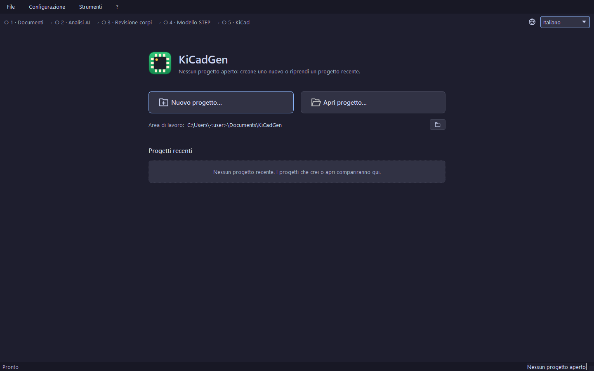

Senza un progetto aperto la finestra mostra una pagina iniziale: **Nuovo
progetto…** (Ctrl+N), **Apri progetto…** (Ctrl+O) e l'elenco dei progetti
recenti (un clic ne riapre uno; il menu del tasto destro lo toglie
dall'elenco). Un progetto è una cartella nell'**area di lavoro**
(`Documents\KiCadGen`, «Documenti» in Esplora file, nel programma installato, `generated\` dai sorgenti; il
pulsante con la cartella accanto al campo ne sceglie un'altra). Il suo nome è
anche il nome del footprint, del simbolo e del modello STEP; **File → Rinomina
progetto…** (F2) rinomina insieme cartella e file.

### Menu

- **File**: nuovo, apri, rinomina, progetti recenti, esci.
- **Configurazione**: «Gestione tipologie e profili AI…» (tipologie di
  componente e loro prompt, nel catalogo SQLite
  `data/analysis_profiles.sqlite3`), «Default generali AI…» (il modello AI
  unico con la sua sorgente, OpenRouter o DeepSeek, e i prompt base nelle
  schede Modello, Datasheet, Localizzazione foto, Verifica foto), «Account
  AI…», «Opzioni di generazione…» (pin NC, sigle incise, pausa dopo
  l'inventario AI), «Archivio abbinamenti accettati…».
- **Strumenti**: apri cartella componente, i tre comandi KiCad (anche nella
  scheda KiCad), apri la cartella dati del programma e `config.json`.
- **?**: «Guida d'uso» (la guida HTML distribuita con il programma), «Apri
  cartella dei log», «Segnala un problema…», «Controlla aggiornamenti…»,
  «Licenze», «Informazioni su KiCadGen», «Scorciatoie da tastiera…».

### Barra del flusso e schede

Sopra le schede una barra mostra le fasi del lavoro — **Documenti › Analisi
AI › Revisione corpi › Modello STEP › KiCad** — con quelle concluse spuntate,
quella corrente evidenziata e quelle che non si applicano attenuate (la
revisione dei corpi per un componente singolo). Un clic su una fase porta
alla sua scheda. A destra, il selettore della lingua: italiano, inglese,
francese, tedesco (i testi vengono dallo stesso catalogo SQLite; le voci
mancanti ricadono sull'inglese).

Le schede sono **Progetto** (Ctrl+1), **Anteprima footprint** (Ctrl+2),
**Simbolo elettrico** (Ctrl+3), **Modello STEP** (Ctrl+4), **KiCad** (Ctrl+5) ed
**Esportazioni** (Ctrl+6).

## Dati in ingresso

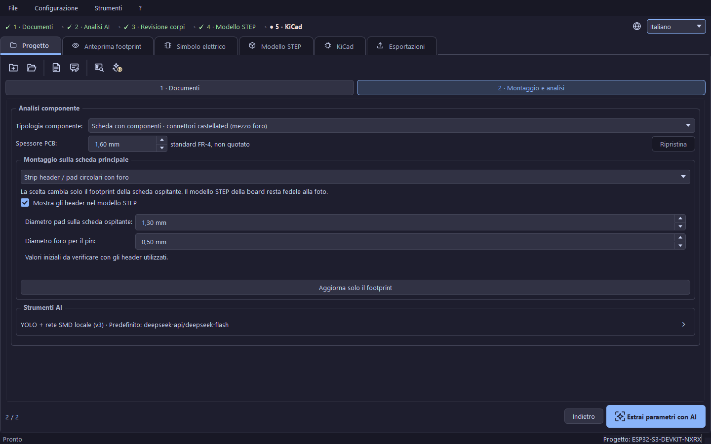

La scheda Progetto guida la preparazione in due passi, **Documenti** e
**Montaggio e analisi**, con **Continua** / **Indietro** (**Torna ai
progetti** nel primo passo salva e torna alla pagina iniziale). Il pannello
richiudibile **Dati del progetto** contiene nome e area di lavoro.

### Documenti e ruoli

**Aggiungi…** copia un file (PDF, PNG, JPG, WEBP, GIF) nella cartella `docs`
del progetto; l'originale non viene toccato. Ogni file ha una scheda in cui
spunti i ruoli che contiene:

| Ruolo | Contenuto |
|---|---|
| Pinout | numerazione e posizione dei contatti; il modello dice da che lato è visto il disegno e la specchiatura la fa il codice |
| Quote | il disegno quotato dall'alto: lunghezza e larghezza del corpo, fori, distanza fra le file |
| Alta risoluzione | una fotografia vera dall'alto: l'unico ruolo inviato al rilevatore dei componenti e alla calibrazione; solo immagini |
| Piazzole | le piazzole consigliate dal costruttore (land pattern) |
| Vista laterale | le altezze: corpo, componenti, spessore della scheda |
| Datasheet | il datasheet completo del costruttore; un PDF prende sempre questo ruolo da solo e l'estrazione vi cerca pinout, quote, piazzole e vista laterale |

Un file senza ruoli blocca l'analisi finché non ne spunti uno o lo rimuovi. I
pulsanti della scheda sostituiscono il file (mantenendo i ruoli), aprono
un'anteprima con zoom o tolgono la copia locale (recuperabile da
`docs/.history`). Un ruolo che nessun file fornisce è «non fornito»: il
modello lo sa e non lo sostituisce con altri file.

Le foto dall'alto vengono calibrate sulle quote della scheda, asse per asse.
Devono essere scattate dall'alto, quasi ortogonali, con il lato lungo della
scheda in orizzontale e il contorno distinguibile dallo sfondo; la
prospettiva non viene corretta, una foto inclinata viene rifiutata. Ogni
immagine viene ricodificata **senza metadati** (GPS, dispositivo) prima di
raggiungere un provider; un'immagine i cui metadati non si possono togliere
viene rifiutata, con l'invito a salvarla come JPEG o PNG.

### Tipologia e parametri manuali

**Tipologia componente** dice al modello che cosa sta leggendo:

- *Componente singolo a fori passanti (THT)* — piazzole con foro; il
  riquadro «Piazzole del componente THT» (Ø pad, Ø foro, «Rigenera
  footprint»);
- *Componente singolo SMD* — nessun foro, piazzole dal land pattern;
- *Scheda con componenti · connettori passanti* e *Scheda con componenti ·
  connettori castellated (mezzo foro)* — oltre al footprint parte
  l'inventario fotografico dei corpi montati.

Senza una tipologia l'analisi è bloccata. Per le schede, **Montaggio sulla
scheda principale** sceglie come il modulo sta sulla scheda ospitante
(saldatura diretta / piazzole del modulo; strip header con pad circolari o
quadrati, con diametri di pad e foro); **Mostra gli header nel modello STEP**
aggiunge i maschi sotto la scheda nel solo modello STEP (sulle castellated solo
sui contatti con foro passante). **Spessore PCB** mostra lo spessore con la
sua provenienza (dai documenti, stimato dall'AI, impostato da te;
«Ripristina» torna indietro).

I parametri del pin header (righe, colonne, passo, interasse, diametri di pad
e foro) e quelli castellated (corpo, piazzola, sporgenza, diametro del
semi-foro, spessore) sono dati del progetto con intervalli validati:
l'analisi li compila e l'anteprima del footprint modifica le piazzole
ospitanti. Un pin header inserito a mano senza analisi ha un footprint
corretto ma **nessun corpo 3D** (decisione dell'utente del 15/10/2026); chiede
comunque le parole chiave prima dell'installazione.

Il riquadro richiudibile **Strumenti AI** mostra rilevatore e modello in uso:

- **Rilevamento foto** (solo schede): *YOLO + rete SMD locale (v3)* (default
  dai sorgenti: la rete locale classifica i corpi tenuti e solo quelli che non
  risolve vanno all'AI), *YOLO locale + verifica AI* (default nel programma
  installato, che non include PyTorch), *AI (attuale)*, *Solo modello di
  visione (nessun rilevatore locale)*, *Solo YOLO locale (pretest, nessuna
  AI)*. La riga *Modello YOLO* apre un selettore che mostra, per ogni file di
  pesi, formato, dimensione, origine, licenza, classi e compatibilità; un
  checkpoint YOLO `.pt` esegue codice al caricamento, quindi viene controllato
  solo con «Verifica compatibilità». La riga *Modello rete SMD* apre un
  selettore distinto che mostra dimensione, data, SHA-256 e ciò che il
  checkpoint dichiara di sé (architettura, addestramento, classi, tipi di
  rotazione, soglia, metriche); legge il checkpoint con `weights_only=True`,
  quindi nessun codice del file viene eseguito, e non ha il pulsante «Verifica
  compatibilità». Vedi
  [docs/yolo-photo-workflow.md](docs/yolo-photo-workflow.md) e
  [docs/CLASSIFICATORE_SMD.md](docs/CLASSIFICATORE_SMD.md).
- **Modello AI**: il modello unico usato per documenti, foto e verifica; il
  pulsante accanto lo cambia solo per questa sessione (filtro per costo,
  sorgente OpenRouter o DeepSeek).

## Analisi

**Estrai parametri con AI** avvia l'analisi a pagamento. Una finestra di
avanzamento elenca le fasi e chi lavora in ciascuna — *Modello AI*, *Lettura
ritagli*, *Lettura sigle* (remote, a pagamento), *YOLO*, *Rete SMD locale*,
*OpenCV*, *KiCadGen (footprint 2D)*, *Libreria modelli STEP di KiCad*,
*Consolidati*, *FreeCAD* (locali) — con il costo dell'analisi; **Interrompi**
la ferma (una richiesta già inviata deve concludersi; non ne partono altre).
Il log AI (Ctrl+L) viene scritto in `analisi-ai.log` nella cartella del
progetto.

Che cosa succede, in ordine:

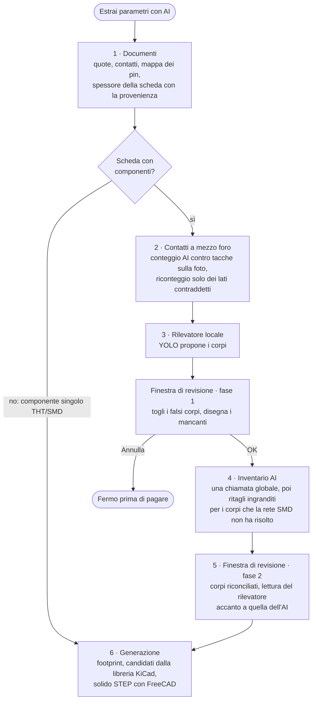

1. **Documenti**: quote, contatti, mappa dei pin, spessore della scheda e
   loro provenienza. Una nuova analisi che scarterebbe nomi dei pin scritti da
   te lo chiede prima. I dubbi sull'orientamento del package (corpo che copre
   le piazzole, vista dal basso specchiata) vengono chiesti, mai risolti in
   silenzio. Passo e interasse del pin header restano distinti; un interasse
   non letto non posiziona fori, e una larghezza di piazzola pari al passo non
   è una misura.
2. **Contatti castellated**: l'AI conta i semi-fori già nella prima chiamata;
   la foto conta poi le tacche del contorno su ogni bordo. Un lato dichiarato
   su un bordo senza tacche viene escluso, un conteggio diverso viene
   ricontato dal modello sull'ingrandimento del bordo (solo i lati
   contraddetti) e sui lati confermati le piazzole vengono **misurate** sulla
   foto (registrate come «measured», mai al posto di una quota letta nei
   documenti).
3. **Rilevatore locale** (schede): YOLO propone i corpi sulla foto calibrata.
   La **finestra di revisione** si apre nella prima fase con le proposte del
   rilevatore: togli i rettangoli su scritte, fori o piazzole vuote, traccia
   quelli mancanti, poi OK manda avanti le proposte tenute; Annulla si ferma
   prima di pagare. Le proposte sono salvate in `photo-review/` e si riaprono
   gratis.
4. **Inventario AI**: una chiamata globale sull'intera scheda, poi — per i
   corpi che la rete SMD locale non ha risolto — ogni corpo viene riletto due
   volte dal suo ritaglio ingrandito con un questionario visivo; la classe la
   deriva il programma dalle osservazioni e si adotta solo ciò su cui le due
   letture concordano. Le contraddizioni con l'inventario vengono segnalate
   per la revisione. I corpi proposti dalla sola AI vengono confrontati con il
   rilevatore locale e partono esclusi finché non li tieni. Le misure stimate
   non vengono mai usate come misure.
5. **Pausa dopo l'inventario** (attiva per default, Configurazione → Opzioni
   di generazione…): la finestra di revisione si apre nella seconda fase con i
   corpi riconciliati, la lettura del rilevatore accanto a quella dell'AI (mai
   sovrascritta), il riquadro originale del rilevatore come fantasma
   tratteggiato, i marcatori delle righe con avvisi o con tipo non stabilito.
6. **Generazione**: footprint, modelli candidati dalla libreria KiCad (FreeCAD
   misura quelli non ancora in cache), solido STEP con FreeCAD.

### La finestra di revisione

Una sola finestra, due fasi. Barra: **Aggiungi componente** (R), **Elimina
selezionato** (Canc), **Lazo** (L), **Tieni o lascia** i corpi aggiunti dal
solo modello (T), **Copia formato** (incolla misure, altezza, tipologia,
package e modello KiCad su altri corpi), zoom, **Adatta foto** (F),
visibilità della foto (P: intera, attenuata, nascosta), dettagli, dubbi del
modello. Centro e lati si correggono trascinando il rettangolo e le sue
maniglie; la rotazione solo con il campo numerico «Rotazione» di
**Parametri…**, che apre una modale con tre sezioni di sola lettura (rilevatore
locale, AI, modello KiCad) e le correzioni modificabili, più **Scegli modello
KiCad…**. **Applica correzioni** salva; **Annulla** lascia tutto com'era. Più
tardi, dalla scheda Progetto, **Revisione componenti…** riapre gratis la fase
salvata e **Rilancia inventario AI (a pagamento)…** rifà solo l'inventario AI
sulle proposte salvate.

## Risultati

### Anteprima footprint

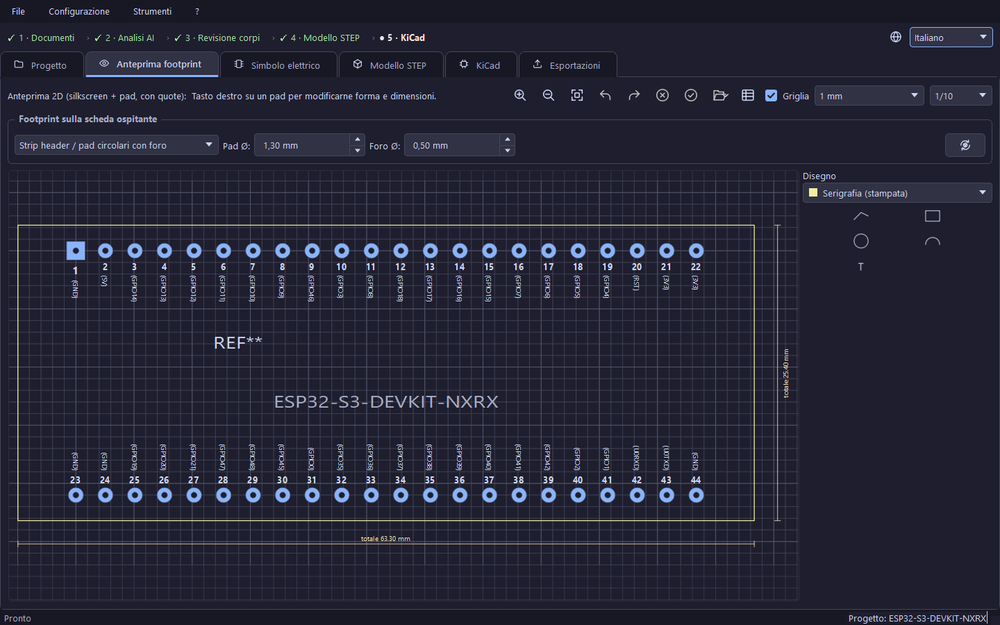

Il disegno 2D in scala con quote e numeri dei pin, una griglia (1 mm o
0.1 in) con una sotto-griglia puntinata per i disegni, i colori dei layer di
KiCad e la camera conservata. L'anteprima è una **bozza** come il simbolo: i
testi Reference e Value si trascinano, i disegni si aggiungono dalla
tavolozza, le piazzole ospitanti si modificano («Footprint sulla scheda
ospitante»: saldatura diretta o strip header, diametri di pad e foro), con
annulla/ripeti; **Applica** scrive il `.kicad_mod`, **Annulla** scarta,
**Recupera bozza** ripristina una bozza non applicata dopo un crash
(`.footprint-draft.json` nel progetto). «Aggiorna solo il footprint» riscrive
il file dalla scelta di montaggio senza chiamare l'AI né ricostruire il 3D.

### Simbolo elettrico

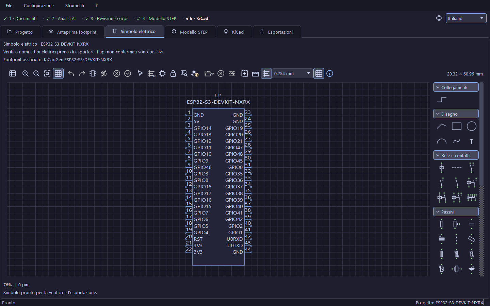

I numeri dei pin sono quelli delle piazzole del footprint e non si cambiano
nella tabella; nomi e tipi elettrici sì. L'editor sposta i pin liberamente
(punto di connessione sulla griglia da 0.1 in), li ruota, ridimensiona il
rettangolo, seleziona gruppi, allinea e distribuisce, aggiunge fili e glifi
dal catalogo, con annulla/ripeti, bozza recuperata dopo un crash e
**Applica** / **Annulla**. **Controlla simbolo** segnala nomi mancanti, testi
sovrapposti e tipi passivi non verificati; lo stesso controllo precede
l'esportazione. **Suggerisci tipi pin con AI** propone i tipi elettrici dai
documenti pinout o datasheet (a pagamento; le proposte hanno fonte e
motivazione e si scelgono una per una). **Esporta simbolo KiCad** scrive il
`.kicad_sym` con il collegamento al footprint `KiCadGen:<nome>`. I tipi
iniziali sono *passive*: verificali sul datasheet prima di affidarti all'ERC
di KiCad.

### Modello STEP


Rotazione con il mouse, cubo di navigazione per le viste standard. Barra:
numeri dei pin (visibili dal lato dei piedini, un controllo pratico della
specchiatura), tabella pinout, inquadra, apri la cartella `3dshapes`,
**Rigenera modello STEP con queste annotazioni** (F5, gratuito), **Accetto, mi piace — ricorda questi
modelli…** (salva gli abbinamenti corpo/modello per le schede future),
**Copia formato**. **Modifica componenti…** (Ctrl+E, o tasto destro su un
corpo) modifica a mano nome, tipo, posizione, quote, rotazione, colore e
marcatura, anche senza la foto; il menu del tasto destro offre anche *Elimina
dal modello STEP (falso positivo)*, *Rimetti nel modello STEP*, *Ruota il solido*,
*Cambia modello KiCad…*.

**Scelta del modello STEP** mostra fino a cinque candidati della libreria
KiCad con le loro misure accanto al ritaglio della foto; l'anteprima è
orientata come montata, con rotazione manuale o automatica. Un abbinamento
dimensionale non è un'identità elettrica verificata: il rapporto distingue
`auto_matched` da `confirmed`. Dettagli:
[docs/interactive-kicad-models.md](docs/interactive-kicad-models.md).

Altezze dei corpi, contatti nascosti, pin 1 e polarità non si ricavano da una
foto dall'alto: restano da verificare.

### Cartella del progetto

```text
<Nome>/
├── <Nome>.pretty/<Nome>.kicad_mod
├── <Nome>.3dshapes/<Nome>.step, .wrl, .preview.json
├── <Nome>.kicad_sym                (dopo «Esporta simbolo KiCad»)
├── project_config.json             (il file del progetto: impostazioni, tabelle, annotazioni)
├── docs/                           (i tuoi documenti, .document-roles.json, .history/)
├── photo-cache/                    (risposte AI, per modello, prompt e pixel; senza chiavi)
├── photo-review/                   (proposte del rilevatore e revisioni salvate)
├── yolo-pretest/                   (photo-review/ e photo-cache/ di «Solo YOLO locale»)
├── kicad-model-candidates.json, kicad-model-choices.json
├── consolidated-matches.json       (confronto con gli abbinamenti accettati)
├── .header-model-reuse.json        (modello STEP degli header riusato, schede con header)
├── ai-costs.json, analisi-ai.log, freecad.log
└── .kicad-preview/                 (il progetto isolato di prova)
```

I file generati restano locali finché non li installi esplicitamente.

## La scheda KiCad

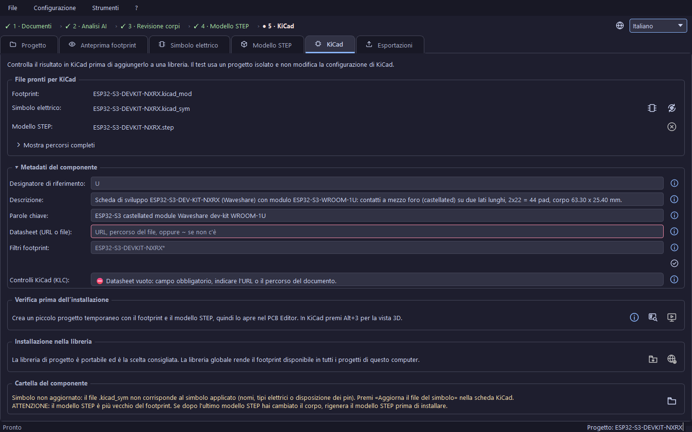

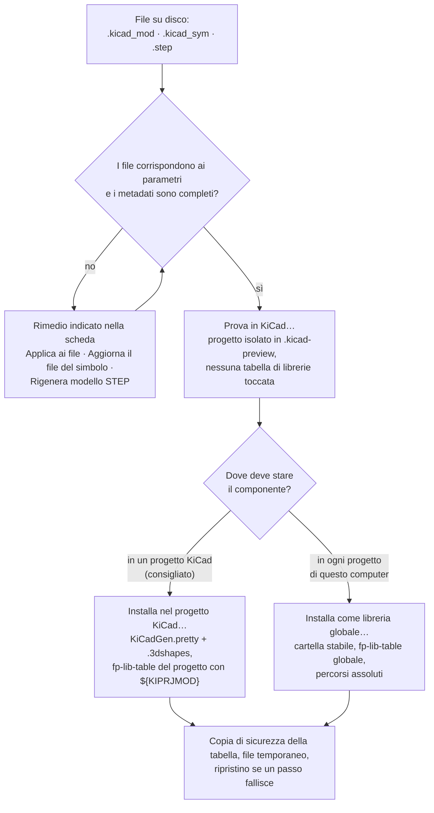

**File pronti per KiCad** elenca footprint, simbolo e STEP con il loro stato.
Installazione e prova isolata sono **bloccate finché i file su disco non
corrispondono ai parametri** e ogni blocco nomina il suo rimedio, abilitato
finché il blocco resta: *Applica ai file* (metadati, footprint) e *Aggiorna il
file del simbolo* in questa scheda; per uno STEP che non corrisponde più
(anche dopo un cambio di soli colori o annotazioni 3D) il pulsante di
rigenerazione nella barra della scheda Modello STEP («Rigenera modello STEP
con queste annotazioni»), oppure qui *Rimuovi il modello STEP obsoleto* (uno
STEP vecchio che non si può ricostruire). I progetti salvati da versioni
precedenti possono richiedere un «Applica ai file». I comandi sono bloccati
anche mentre gira un lavoro in background. Usano i file **applicati**: una
bozza non applicata del footprint o del simbolo non viene installata, non
blocca i comandi e la segnala «Verifica componente per KiCad».

**Metadati del componente** (chiuso per default): designatore di riferimento
(solo lettere; la proposta in grigio conta come compilata), descrizione,
parole chiave, datasheet (URL o file), filtri footprint. Designatore,
descrizione, parole chiave e datasheet sono **obbligatori** prima
dell'installazione. L'elenco **Controlli KiCad (KLC)** si aggiorna mentre
scrivi (⛔ errore, ⚠ avviso) e «Applica ai file» scrive i valori nel footprint
e nel simbolo.

**Verifica prima dell'installazione**:

- **Prova in KiCad…** crea un piccolo progetto temporaneo nella cartella
  `.kicad-preview` del componente, con il footprint incorporato e una copia
  locale dello STEP referenziata con `${KIPRJMOD}`, e lo apre nel PCB Editor
  (Alt+3 per la vista 3D). **Nessuna tabella di librerie viene toccata.**
- **Verifica componente per KiCad** esegue controlli di sola lettura in un
  worker e mostra un rapporto copiabile: footprint su disco, corrispondenza
  pin–pad, collegamento 3D originale, integrità STEP, simbolo esportato
  confrontato con quello applicato e — se `kicad-cli` è disponibile —
  l'apertura reale di footprint, simbolo e importazione 3D in una cartella
  temporanea. Non certifica pinout, misure o allineamento visivo; ERC e DRC
  restano sul progetto finale.
- **Guida rapida per usare il componente in KiCad** apre una procedura in cinque pagine sull'uso del
  componente in KiCad.

**Installazione nella libreria**:

| Comando | Che cosa scrive |
|---|---|
| **Installa nel progetto KiCad…** (consigliato) | crea o aggiorna `KiCadGen.pretty` e `KiCadGen.3dshapes` nel progetto KiCad scelto e registra la libreria dei footprint nella `fp-lib-table` di quel progetto con percorsi `${KIPRJMOD}`, così il progetto resta portabile |
| **Installa come libreria globale…** | copia gli stessi file in una cartella stabile scelta da te e registra `KiCadGen.pretty` nella `fp-lib-table` globale per utente del KiCad installato (trovata tramite `kicad-cli version`), con percorsi assoluti. Viene rifiutata finché quella tabella non esiste: avvia KiCad una volta, completa la configurazione iniziale delle librerie e riprova |

Vengono sostituiti solo i file del componente corrente, dopo conferma
esplicita; gli altri componenti e le altre righe della tabella sono
preservati. Prima di cambiare una tabella il programma conserva
`<tabella>.kicadgen-backup` (a rotazione), scrive su un file di appoggio e
annulla tutto ciò che ha toccato se un passo fallisce. Una tabella non UTF-8
o una scrittura rifiutata dal sistema viene segnalata con il percorso reale.

Il **simbolo** non viene registrato in nessuna `sym-lib-table`: esporta il
`.kicad_sym` e aggiungilo in KiCad con *Gestisci librerie di simboli*, poi
imposta il Footprint del simbolo su `KiCadGen:<nome>`.

La scheda **Esportazioni** conserva lo storico di ogni installazione ed
esportazione del simbolo fatta da questo computer (componente, tipo,
destinazione, data).

## Log, problemi, aggiornamenti

| File | Dove | Contenuto |
|---|---|---|
| `analisi-ai.log` | cartella del progetto | il diario dell'analisi: passi, modelli, costi, avvisi |
| `freecad.log` | cartella del progetto | l'uscita di FreeCAD durante la costruzione del 3D |
| `crash-reports/` | `%LOCALAPPDATA%\KiCadGen\logs` (installato) | un file per ogni errore imprevisto: versione, sistema, traccia; restano solo i 20 più recenti |

**? → Segnala un problema…** apre una nuova segnalazione GitHub precompilata
con le sole versioni e apre la cartella dei log: alleghi tu ciò che vuoi dopo
averlo letto. **? → Controlla aggiornamenti…** confronta questa versione con
l'ultima release su GitHub, solo quando lo chiedi. L'unica chiamata di rete
fatta all'avvio legge il saldo del fornitore AI (OpenRouter o DeepSeek) di cui
è configurata la chiave API; senza chiave non parte nulla. Nessun'altra
chiamata all'avvio.

## Limiti ed euristiche note

- L'AI può sbagliare: controlla sempre le anteprime prima di usare un
  risultato.
- Le altezze da una sola foto dall'alto sono stime; lo è anche uno spessore
  della scheda non quotato nei documenti (si usa il valore standard e lo si
  scrive nel log).
- L'inventario fotografico può perdere corpi o tenere non-corpi; per questo
  esistono la revisione e «Modifica componenti…». Il numero di corpi trovati
  non misura la precisione.
- Il conteggio delle tacche dei contatti castellated conta solo i semi-fori
  aperti; una serie che tocca l'estremità del bordo dà un limite inferiore,
  non un conteggio.
- Il dubbio sull'orientamento dei package si basa sull'assunto IPC «larghezza
  della piazzola ≈ larghezza del piedino»; una piazzola letta esattamente sul
  bordo del corpo può dare un falso dubbio e un TSSOP trasposto non è
  rilevabile.
- L'abbinamento con la libreria KiCad confronta misure (tolleranza 30 %, al
  massimo 64 candidati misurati per ricerca): una corrispondenza dimensionale
  non è un'identità.
- Documenti, fotografie, modelli generati e librerie di terze parti possono
  avere copyright o limiti d'uso propri.

## Struttura del repository

```text
main.py                          avvio della GUI (usa la .venv se presente)
kicadgen/core/                   modelli dati KiCad e scrittura S-expression
kicadgen/generators/             generatori di footprint e simbolo
kicadgen/cad3d/                  orchestrazione FreeCAD, abbinamento modelli KiCad
kicadgen/services/               provider AI, profili, documenti, pipeline foto, libreria KiCad
kicadgen/gui/                    interfaccia Qt, anteprime, help/guida.html
data/analysis_profiles.sqlite3   catalogo profili e traduzioni (versionato)
docs/                            documentazione per utenti e manutentori
examples/, tools/                esempi da riga di comando e strumenti di manutenzione
packaging/, scripts/             spec PyInstaller, sorgente WiX, script di build e rilascio
tests/                           test di regressione e GUI
```

Come i pacchetti dipendono l'uno dall'altro (una freccia vuol dire «usa»):

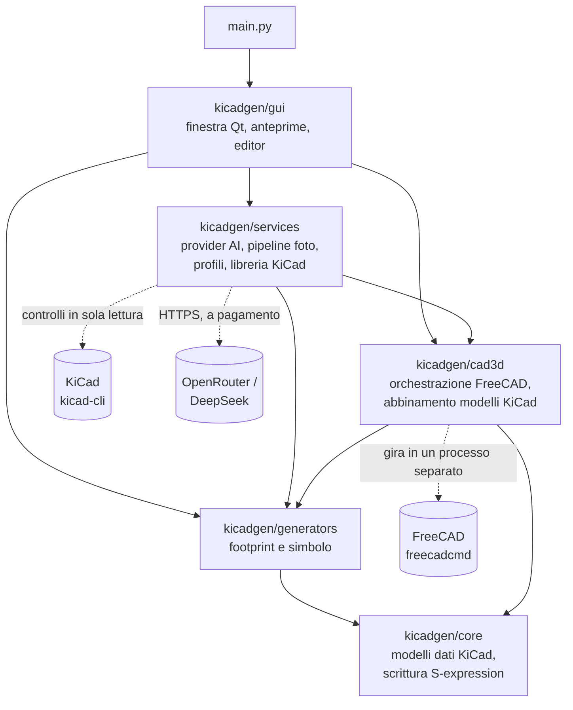

Il diagramma mostra solo la direzione principale: ogni pacchetto usa anche
`kicadgen/services/messages.py` per i messaggi tradotti.

## Test

```powershell
.venv/Scripts/python.exe -m pytest -q -p no:cacheprovider --basetemp=.venv/claude-test-run
```

La suite è ampia (quasi diecimila test; il conteggio aggiornato è in
`HANDOFF.md`) e in CI gira in due metà
(`tools/run_test_halves.py`) perché un processo unico può morire con un crash
nativo Qt/VTK. Usa una directory temporanea nuova per ogni esecuzione.

## Licenza

Il codice sorgente e la documentazione di KiCadGen sono distribuiti con la
**GNU Affero General Public License v3.0** (`LICENSE`).
Copyright (c) 2026 Mirko Ugolini.

Fino al 25/09/2026 il progetto era MIT. È passato ad AGPL-3.0 perché usa
Ultralytics (AGPL-3.0) per i modelli YOLO `.pt` e perché i pesi YOLO usati
dichiarano AGPL-3.0.

I pesi dei modelli YOLO e il dataset di addestramento **hanno licenze proprie,
che possono essere diverse da quella del codice**. Sono elencati uno per uno in
`THIRD_PARTY_NOTICES.md`, insieme alle dipendenze Python:

- nel repository non ci sono pesi né le loro cartelle: `models/yolo/` per i
  rilevatori e `models/smd/` per la rete SMD si creano quando aggiungi i file
  (Git ignora i file di pesi `.pt` e `.onnx`). I checkpoint usati
  nello sviluppo dichiarano AGPL-3.0 nei metadati. Il modello ONNX di base è
  ridistribuito come AGPL-3.0 (MIT nella model card, AGPL-3.0 nei metadati:
  vale la più restrittiva);
- il modello YOLO26 Large è addestrato sul
  [dataset CompDetect](https://universe.roboflow.com/dataset-lmrsw/compdetect),
  con licenza [CC BY 4.0](https://creativecommons.org/licenses/by/4.0/); il
  YOLOv8m sul dataset
  [Detecting the PCB object](https://universe.roboflow.com/arshiasbn-4s0xh/detecting-the-pcb-object)
  di Arshiasbn, con licenza MIT. Il
  dataset è stato esportato da Roboflow per l'addestramento; le elaborazioni
  applicate davvero (ridimensionamento, aumentazione, conversione, filtri,
  modifiche alle classi) **vanno registrate** in `THIRD_PARTY_NOTICES.md` e
  sono ancora da registrare. Il dataset non è ridistribuito qui e i suoi
  autori non avallano questo progetto;
- FreeCAD e KiCad sono programmi separati, con licenze proprie, e non sono
  inclusi;
- l'installer Windows include anche il runtime CPython, le librerie Qt 6,
  PyQt6 e la libreria FFmpeg distribuita con OpenCV, ognuno con la propria
  licenza (PSF-2.0, LGPL-3.0, GPL-3.0, LGPL-2.1); i loro file di licenza sono
  copiati nella cartella `_internal\licenses` del programma installato e
  `THIRD_PARTY_NOTICES.md` li elenca con le sorgenti a monte.

Footprint e modelli STEP generati, datasheet e foto forniti dall'utente possono
avere licenze o limiti d'uso propri, da verificare. Questa sezione non afferma
che un uso, commerciale o no, sia consentito oltre quanto dicono le singole
licenze.
